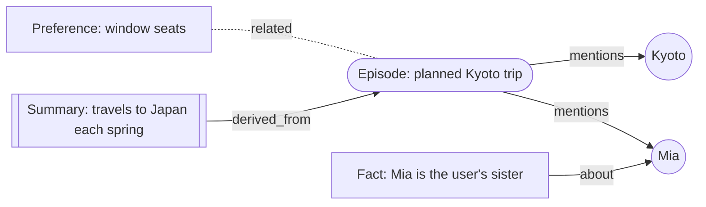

<div align="center">

# NEO

One continuous timeline, with automatic bounded episodes for context and an off-record mode for ephemeral exchanges.

**An open-source personal AI assistant you can make your own.**

You choose the AI, what it remembers, and whether it runs on your device or your own server.

[Features](#features) · [Quick start](#quick-start) · [How memory works](#a-memory-net-not-a-notepad) · [Architecture](docs/ARCHITECTURE.md) · [Deployment](docs/DEPLOYMENT.md) · [中文](#中文简介)

</div>

---

## Features

- **🧠 A memory net, like a person's.** NEO stores episodes, facts, people and places, preferences, skills and goals as a network of associations. When you talk, activation spreads through the net, so NEO is *reminded* of related things, not only keyword matches. Unused memories fade, recalled ones grow stronger, and while idle NEO consolidates experiences into knowledge and writes a dream journal of what it learned.
- **🔑 You choose what it remembers.** You can see the whole net and edit, pin or forget anything. NEO remembers what matters automatically. You can use off-record exchanges, keep sensitive memories away from cloud models, and export or import everything as JSON.
- **🤖 You choose the AI.** Sign in with OpenRouter for Claude, GPT, Gemini and more, or paste a provider API key. Simple mode verifies it and chooses models for you; Advanced lets Text, Memory and future Voice, Image and Video features use separate providers and models. Local/custom endpoints (Ollama, LM Studio, vLLM, llama.cpp, Groq…) are configured in Advanced. Every turn uses the global Text capability.
- **🏠 You choose where it runs.** **On-device**: the desktop app runs everything locally. **Self-hosted**: one Node process or Docker container on your own server, with your phone, browser and terminal paired to it by QR code.
- **🛠 Tools that get things done.** Reminders with a reliable scheduler (timezone and DST-safe recurrences, catch-up after downtime) and notifications on every platform. Also tasks, notes, web fetch/search, a calculator, memory tools and plugins. Risky actions ask first.
- **✨ Generated UI on every platform.** NEO answers with native cards, tables, charts, forms, timelines, live reminder and task widgets, and more. They render on web, desktop and mobile, and as clean text in the terminal. It's declarative data, never code, so it is safe by design.

## Quick start

Requirements: **Node.js ≥ 22.13** and **pnpm** (`corepack enable`).

```bash
git clone https://github.com/RichardZhengQuan/NEO.git
cd NEO
pnpm install
pnpm build
```

Run NEO on this machine and open the app:

```bash
node packages/cli/dist/index.js serve
```

Then open `http://127.0.0.1:7777` and follow the onboarding: choose an avatar, connect your AI, learn how memory works, and set up notifications. NEO's personality grows from conversations: tell it how you prefer answers, what to call you, or which language to use, and it remembers. You can skip AI setup for now and connect later in **Settings → AI**. A fresh install has no AI connected; chatting requires a provider.

To connect an AI, choose **Sign in with ChatGPT** to use your Plus or Pro plan for text when NEO runs on this computer, choose **Sign in with OpenRouter**, or paste an Anthropic, OpenAI, Gemini or OpenRouter API key in **Simple** mode. NEO detects the key format, tests the connection and shows the models it selected. If the format is unknown, choose the provider from the small selector. Remote servers use API keys or OpenRouter; transferring ChatGPT credentials to VMs is out of scope.

Use **Advanced** to choose a provider/model for each capability or **Add a custom endpoint** with its base URL and optional key. Text handles chat, titles and memory extraction. Memory uses embeddings, with a local hashing fallback when unassigned. Voice, Image and Video assignments can be saved now for future features; those features are not available yet. API keys are encrypted on the server and never sent back to the app. See [Providers](docs/PROVIDERS.md) for details.

Prefer the terminal?

```bash
node packages/cli/dist/index.js chat
```

Self-host with Docker:

```bash
docker compose up -d                     # NEO on :7777, data in a volume
docker compose --profile local-ai up -d  # + Ollama for fully local models
```

See [docs/DEPLOYMENT.md](docs/DEPLOYMENT.md) for TLS, pairing your phone, backups and the desktop and mobile apps.

## A memory net, not a notepad



1. **Recall**: your message seeds activation by meaning (embeddings), keywords and names. Activation then spreads two hops along weighted links. Strength depends on relevance × retention × importance × confidence. NEO can always tell you *why* it remembered something.
2. **Forgetting curve**: retention `R = e^(−Δt/S)`. Each recall raises stability `S`, and raises it most when a memory was nearly forgotten (the spacing effect). Memories used together get linked (Hebbian learning).
3. **Write-back**: after each exchange, NEO extracts what's worth keeping. It dedupes, updates or *supersedes* old beliefs (keeping history), links people and places, and respects your policy.
4. **Sleep**: consolidation fades and archives stale memories, prunes weak links, discovers new ones, merges duplicate people, and abstracts episodes into lasting knowledge.

The full algorithm is in [docs/MEMORY.md](docs/MEMORY.md).

## Architecture

```
packages/  protocol · tunnel · relay · storage · providers · memory · tools · core · server · client · ui · cli
apps/      web (PWA) · desktop (Electron) · mobile (Capacitor)
```

It's a TypeScript monorepo. `@neo/protocol` holds the shared contracts (zod), so the server, apps and plugins all agree on types. Storage is a single SQLite file through Node's built-in `node:sqlite`, with no native modules. The agent runtime keeps transcripts append-only so prompt caching and model reasoning replay keep working across turns. Read more in [docs/ARCHITECTURE.md](docs/ARCHITECTURE.md), [docs/API.md](docs/API.md), [docs/TOOLS.md](docs/TOOLS.md), [docs/GENERATIVE_UI.md](docs/GENERATIVE_UI.md) and [docs/PROVIDERS.md](docs/PROVIDERS.md).

## Development

```bash
pnpm install
pnpm typecheck        # all packages
pnpm test             # all tests (offline)
pnpm build            # build everything (topological)
pnpm dev:web          # web app with hot reload (proxies /api to :7777)
```

Packages are tested from their TypeScript sources through the `neo-source` export condition, so you don't need to build before running tests. Plugins are plain ES modules that export tools; see [docs/TOOLS.md](docs/TOOLS.md#plugins).

## Privacy & security

- Your data lives in one directory you control (`~/.neo` by default): the SQLite database, an encryption key for stored API keys, and tokens.
- Nothing leaves your infrastructure except requests to the AI provider you chose. Choose a local model and nothing leaves at all.
- Every device uses its own revocable token. Destructive tools ask for confirmation. Web content is treated as untrusted data. Generated UI can't execute code.

## Roadmap

- MCP client: use tools from any MCP server
- Voice in/out
- Encrypted multi-device sync for on-device installs
- Shared memories between NEOs (with consent)

## License

[MIT](LICENSE)

---

## 中文简介

**NEO 是一个开源、可以真正属于你的个人 AI 助手。** 用什么 AI、记住什么、运行在你的设备上还是你自己的服务器上，都由你决定。

- **网状记忆，像人一样**：情景、事实、人物地点、偏好、技能和目标组成一张联想网络。对话时激活沿着关联扩散，所以 NEO 会被相关的事情“提醒”，而不只是匹配关键词。不常用的记忆会淡忘，被回忆的记忆会加强；空闲时 NEO 会把经历整理成长期知识，并写下“梦境日志”。
- **记什么由你决定**：可视化查看整张记忆网，随时编辑、置顶或遗忘；可以要求新记忆先经你确认，屏蔽某些话题，使用无痕对话，敏感记忆不发送给云端模型，并能导入导出全部记忆。
- **AI 由你选择**：NEO 在本机运行时，可以登录 ChatGPT，通过 Plus 或 Pro 套餐生成文本；也可以登录 OpenRouter，或在「简单」模式粘贴 Anthropic、OpenAI、Gemini 或 OpenRouter 的 API 密钥。NEO 会识别提供商、验证连接并选择模型，未知格式会显示提供商选择框。远程服务器请使用 API 密钥或 OpenRouter；暂不支持向虚拟机转移 ChatGPT 凭证。
- **按能力配置模型**：「高级」模式可以分别设置文字、记忆、语音、图片和视频所用的提供商及模型；本地或自定义服务通过「添加自定义端点」填写地址及可选密钥。文字负责聊天、标题和记忆提取；记忆未配置嵌入模型时使用本地哈希嵌入器。语音、图片和视频的配置会保存，但这些功能尚未开放。密钥在服务器加密保存，绝不会返回给应用。每个对话仍可单独切换模型；也可以暂时跳过设置，之后在「设置 → AI」中连接。首次安装尚未连接 AI，连接后即可开始聊天。
- **运行在哪里由你决定**：桌面应用把一切都放在本机；也可以部署在自己的服务器上（Node 或 Docker），手机、浏览器和终端扫码配对即可。
- **能干活的工具**：可靠的提醒（支持时区和夏令时，停机后也能补发），所有平台都能收到通知；还有待办、笔记、网页抓取和搜索、计算器、记忆工具与插件。
- **全平台生成式界面**：NEO 会用原生的卡片、表格、图表、表单、时间线以及实时的提醒和待办组件来回答，在网页、桌面和手机上原生渲染，在终端中显示为文本。界面只是声明式数据，不会执行代码。

快速开始见上方 [Quick start](#quick-start)。
